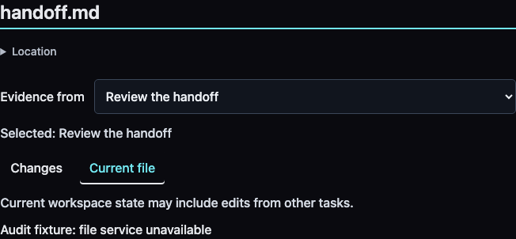

# Interaction audit · 2026-10-29

**Original audit: eight findings.** The user's commit-row complaint is reproduced: the
subject and whitespace are inert, while the evidence icon opens the sources.
Only 3.7% of the sampled row area accepts its sole action. There is an
implementation explanation, but no task-based justification for that restriction.

Remediation is tracked in the [implementation follow-up](INTERACTION_FIXES_2026-10-29.md).
The findings and captures below preserve the pre-fix baseline.

This audit produces the [interaction style guide](INTERACTION_STYLE_GUIDE.md),
repeatable diagnostic probes and a prioritized repair list. It does **not**
implement the product repairs or establish human acceptance.

## Working contract

- **Purpose:** recover outputs, understand changes, inspect their basis, and
  resume work without reconstructing an execution log.
- **Integration:** keep existing source identities, `useFocusWorkspace`, canonical
  routes, request ownership and native disclosure/navigation components.
- **Proof:** source inspection plus isolated Chromium fixture journeys, computed
  styles, pointer probes, keyboard dismissal, reload and injected request failure.
- **Mode:** Muriel Audit / Direct. Define behavior before visual polish; distinguish
  demonstrated defects, source-based risks and human usefulness still untested.

The supplied screenshots and corrections motivated the probes. Runtime evidence
below is from synthetic fixtures, not a claim to have exercised every live session.

## Findings

P1 means a defect or gap in a core review task. P2 means navigation, recovery,
consistency or readability friction. Priorities are judgments, not measured
human impact. Statuses in this section describe the original audit; see the implementation follow-up for current verification.

| ID | Priority | Finding | Evidence |
| --- | --- | --- | --- |
| IA-01 | P1 | Sole commit-row action restricted to the evidence icon | Pointer probe and source |
| IA-02 | P1 | Summary projects the last response; broader findings/open issues remain incomplete | Source and product acceptance gap |
| IA-03 | P1 | Failed document request has no local Retry | Injected failure and reload recovery |
| IA-04 | P2 | Conversation mode is lost on reload | Browser probe and source |
| IA-05 | P2 | Shared-directory and outcome metadata fall below typography floor | Computed styles |
| IA-06 | P2 | Escape on focused exact-time detail closes the inspector | Keyboard probe |
| IA-07 | P2 | File-result navigation uses a button despite canonical destinations | Source inspection only |
| IA-08 | P2 | Timeline live count is not scoped to visible results | Source inspection only |

### IA-01 · Make the sole action occupy the commit header

**Reproduce:** open the paired-commit fixture. Click its subject, its middle
whitespace, then its evidence icon, resetting the disclosure between attempts.

**Observed:** title false; whitespace false; icon true. The row is 1014×63px;
the target is approximately 54×44px (3.7% of the row). Thus a passing 44px glyph
check still permits a largely inert actionable row.

**Owner:** [SessionArtifacts.jsx](../explorer/src/components/SessionArtifacts.jsx),
`OutputList` and `EvidenceActions`. The subject is an inert `strong`; the
`summary` belongs to the separate icon control.

**Contract:** put subject, SHA, whitespace and cue in one native summary when
there are several sources. For one source, use a direct row anchor. Put named
source links in the expanded body; do not nest competing controls or attach a
catch-all click handler to the list item.

**Acceptance:** title, whitespace, icon and Enter/Space all perform the same
appropriate action; one header tab stop; neighboring expanded rows fit at
390px; source links remain independent and reveal their exact destination.


### IA-02 · A last-response projection is not the whole review

**Observed in source:** [session-review.js](../explorer/src/components/session-review.js)
selects `prose('assistant').at(-1)`;
[SessionReview.jsx](../explorer/src/components/SessionReview.jsx) renders the
last response alongside artifacts and research. Attribution is useful and
truthful, but it does not synthesize findings, decisions and evidenced open
issues across the session. This is the existing outcome-first summary backlog,
not a newly discovered runtime exception.

**Contract:** review useful work across the recorded evidence. Separate verified
outputs from recorded claims and historical failures. Preserve sources; never
infer current completion or an unresolved issue merely from an old response.

**Acceptance:** human review of representative sessions can recover what changed,
what was learned and what remains supported as open without reading tool plumbing.
Fixture presence assertions alone cannot close this finding.

### IA-03 · Recover a failed file request where it failed

**Reproduce:** intercept `/api/memory/file` with a 503 in the isolated fixture,
then open the existing document permalink.

**Observed:** the local error appears and the file identity remains in the URL;
there are zero local Retry buttons. Remove the injected failure and reload:
the same file renders successfully. Recovery is possible, but only the broader
reload route was available in this tested state.

**Owner:** [MemoryInspector.jsx](../explorer/src/components/MemoryInspector.jsx),
file request effect and `review.error` branch.

**Contract/acceptance:** retry through the same request owner, keeping file,
contributor, interval and review mode; show loading/failure/recovery truthfully;
late responses must not replace a newer selection. Exercise fail → Retry →
success and selection changes during the retry.



### IA-04 · Preserve the chosen reader mode

**Reproduce:** open a plain session URL, choose Conversation, reload.
**Observed:** Summary is selected after reload.

**Owner:** [TranscriptViewer.jsx](../explorer/src/components/TranscriptViewer.jsx),
local `reviewMode` initialization and toolbar callbacks. Exact UUID/highlight
source links correctly force Conversation; that is a separate working contract.

**Contract/acceptance:** major reader mode belongs in the canonical route. A copied
URL, reload and browser Back preserve the chosen mode; exact source navigation
continues to reveal its block. Do not introduce an independent persisted store.

### IA-05 · Enforce the typography floor on contextual metadata

**Observed computed styles:** shared-directory summary is 14px / weight 400;
outcome offset is 14px / weight 500. Both miss the 16px floor; the former also
misses weight 500. These include recently added context-compression controls.
The copy/contrast checks did not detect this dimension.

**Owners:** [path-context.css](../explorer/src/styles/path-context.css),
[memory-session.css](../explorer/src/styles/memory-session.css).

**Contract/acceptance:** at least 16px / weight 500 for readable metadata and
captions, while preserving 8:1 text contrast. Recheck long directory disclosures,
exact-time detail and 390px overflow after adjustment. This is a project/Muriel
constraint, not a claim that a particular size establishes universal usability.

### IA-06 · Dismiss transient timestamp detail before its parent

**Reproduce:** focus an outcome offset so exact-time detail is visible; press
Escape. **Observed:** the Evidence inspector closes.

**Owners:** exact-time presentation in
[MemorySession.jsx](../explorer/src/components/MemorySession.jsx) and its CSS;
Escape handling in [MemoryInspector.jsx](../explorer/src/components/MemoryInspector.jsx).

**Contract/acceptance:** first Escape dismisses the transient detail while retaining
the review context; a subsequent appropriate Escape closes the inspector and
restores its origin. Exercise pointer, keyboard and touch access to exact time.
Persistent inline disclosures should not all collapse on an unrelated Escape.

### IA-07 · Give navigable file rows native link behavior

**Source observation:** [MemoryDesk.jsx](../explorer/src/components/MemoryDesk.jsx)
uses a button and `onReview` for the primary file row; task rows use anchors.
The workspace already has canonical file destinations. A button does not expose
an `href` for native link copying and modified-click navigation.

**Contract:** navigable destinations get real canonical anchors, with separate
secondary controls. **Acceptance still to run:** modified click/new tab, Enter,
Back, context preservation and no accidental secondary-action activation.
This finding is source-based; no physical middle-click test was performed.

### IA-08 · Make live freshness match the current scope

**Source observation:** [Timeline.jsx](../explorer/src/components/Timeline.jsx)
increments `newCount` for SSE records when scroll exceeds 50px, without a current
scope check. [useFocusWorkspace.js](../explorer/src/hooks/useFocusWorkspace.js)
separately polls at 10 seconds for rolling views and 30 seconds for fixed/demo
views. Therefore it would be inaccurate to say the board never updates.
The concern is the meaning of the count and when invalidation reaches the view.

**Contract:** scope-aware invalidation/counts through the existing owner; fixed
windows remain fixed; reading position, selection and open details stay stable.
**Acceptance still to run:** relevant and irrelevant incoming events, reconnect,
fixed/rolling modes and an open document while updates arrive. Connect this to
the existing live-watch backlog rather than creating a second update system.

## Evidence and limits

Executed against the existing local preview build, with a dirty working tree
based on `ee078ce`. HEAD alone does not identify the uncommitted build. No
production implementation changed for this audit. The probes are opt-in
instrumentation of the existing regression harnesses:

```sh
node tests/browser/session-artifacts.cjs --preview --interaction-audit
node tests/browser/memory-entry.cjs --preview --interaction-audit
```

Both full fixture journeys completed successfully, including their existing
assertions. **That does not mean the interaction audit passed:** the diagnostic
probes intentionally record the known violations above rather than hiding them
inside a green regression result.

- [Artifact probe observations](assets/interaction-audit-2026-10-29/artifact-probes.json)
- [Workspace probe observations](assets/interaction-audit-2026-10-29/workspace-probes.json)
- Screenshots above are synthetic fixtures, inspected after capture; no private
  session screenshots are included in these audit assets.
- Repeated interface copy: all 20 sampled page states were within the 5% gate
  (maximum 4.22%; file review 2.33%). This is a bounded mechanical metric,
  not proof that the pages are useful.
- Existing regression journeys retain named commit sources, exact-source jumps,
  optional-category absence, file permalink recovery, return focus, fixed time
  bounds, narrow layouts and checked 8:1 text contrast. These successes should
  survive the repairs.
- Not established: full accessibility conformance, physical touch/voice/screen-reader
  behavior, real-world comprehension or workload benefit, all failure timings,
  or every live-update transition. No measured human time savings are claimed.

Muriel sources inspected: `SKILL.md`, `channels/interactive.md`,
`references/interaction-contracts.md`, `references/microstrategies.md` in the
installed Muriel skill. Research grounding and its limits are in the style guide.

## Repair order

1. IA-01: whole commit-header activation with existing provenance intact.
2. IA-03/06: local recovery and innermost dismissal, retaining focus/context.
3. IA-04/07: route and native navigation parity.
4. IA-05/08: typography floor and scoped live-update behavior.

IA-02 is the larger product acceptance track alongside these repairs. It must
not disappear merely because the smaller interaction defects become green.
The guide is linked from project instructions and review guards; open work is
tracked in [TODO.md](../TODO.md). This audit authorizes no commit or deployment.
